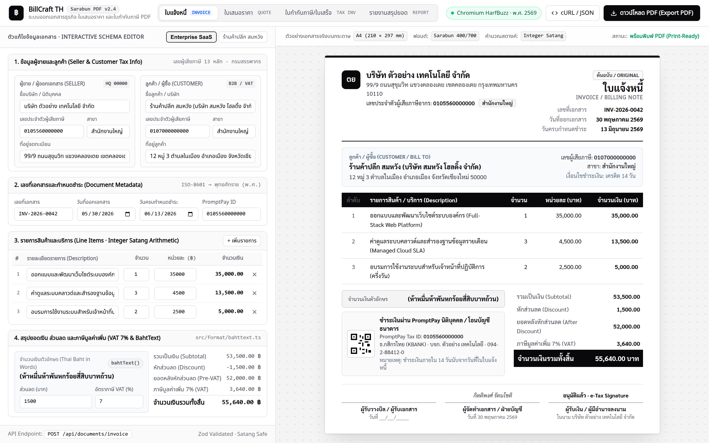

# Thai Document Generator — BillCraft TH

An interactive **Thai Billing, Quotation & Tax Invoice Web Studio + REST API** (and CLI) that turns JSON or interactive studio edits into print-ready PDF business documents — invoices, quotations, tax invoices/receipts, and executive reports — with **correct Thai typography**: proper word breaking, stacked vowel/tone-mark rendering, integer-satang Baht formatting, Thai amount-in-words (`bahttext`), and Buddhist-era (`พ.ศ.`) dates.

Rendering is powered by headless Chromium, whose ICU/HarfBuzz pipeline shapes Thai text accurately out of the box. The **Sarabun** font is bundled (`SIL OFL 1.1`), so output is identical across local, CI, and cloud environments.

[](https://github.com/peemphetpimolzzz/thai-document-generator/actions/workflows/ci.yml)
[](LICENSE)



## Interactive Web Studio (`BillCraft TH`)

Opening `http://localhost:8080/` launches **BillCraft TH**, a split-screen document studio:

- **Document Type Switcher** — Switch between `ใบแจ้งหนี้ (Invoice)`, `ใบเสนอราคา (Quotation)`, `ใบกำกับภาษี/ใบเสร็จ (Tax Invoice)`, and `รายงานสรุปยอด (Executive Report)`.
- **Interactive Schema Editor (Left Pane)** — Edit Seller & Customer 13-digit Tax IDs, branch codes (`สำนักงานใหญ่`), Buddhist-era issue/due dates, PromptPay ID, line items, discounts, and 7% VAT with instant integer-satang calculation and live Thai Baht-in-words (`bahtText()`).
- **Live A4 Paper Preview (Right Pane)** — Real-time A4 sheet preview rendered with bundled `Sarabun` typography, itemized table, PromptPay QR payment block, and authorized signature blocks, plus 1-click **Export PDF (`POST /api/documents/invoice`)** and **cURL / JSON** copy.

## Quick start

> Prerequisites: **Docker and git only.**

```bash
git clone https://github.com/peemphetpimolzzz/thai-document-generator.git
cd thai-document-generator

# Render the bundled samples to ./output/*.pdf — no code required
docker compose run --rm samples

# Or run the Interactive Web Studio + HTTP service on http://localhost:8080
docker compose up --build
curl -X POST http://localhost:8080/api/documents/invoice \
  -H 'Content-Type: application/json' \
  -d @samples/invoice.sample.json -o invoice.pdf
```

## API

Both root routes (`/documents/...`) and `/api`-prefixed routes (`/api/documents/...`) are supported:

| Method | Route | Body | Response |
|--------|-------|------|----------|
| `GET` | `/` | — | Interactive `BillCraft TH` Web Studio (`text/html`) |
| `GET` | `/health` · `/api/health` | — | `{ "status": "ok" }` |
| `GET` | `/ready` · `/api/ready` | — | `200` once Chromium is up |
| `POST` | `/documents/invoice` · `/api/documents/invoice` | invoice JSON | `application/pdf` |
| `POST` | `/documents/report` · `/api/documents/report` | report JSON | `application/pdf` |

Add `?inline=true` to view in the browser instead of downloading. Invalid bodies return a `400` with structured Zod validation issues. See `samples/` for the JSON shapes.

## How Thai rendering stays correct

- **Chromium** performs Thai word segmentation and mark stacking natively via HarfBuzz.
- **Sarabun** (SIL OFL 1.1) is bundled and loaded via `@font-face`; the renderer waits for `document.fonts.ready` before printing, preventing the empty-box (“tofu”) failure mode.
- Money is stored as integer satang internally to avoid floating-point drift, and CSS uses generous line-height with no letter-spacing so Thai marks never collide.

## Tests

```bash
docker build -t thai-doc .
docker run --rm thai-doc npm run test:unit                    # money / amount-in-words / dates / mapping
docker run --rm --shm-size=1g --init thai-doc npm run test:integration   # renders a PDF and asserts the Thai text survives extraction
```

## Configuration

| Env | Default | Purpose |
|-----|---------|---------|
| `PORT` | `8080` | HTTP port |
| `MAX_CONCURRENCY` | `2` | Concurrent renders |
| `FONT_DIR` | `/app/fonts` | Where the bundled fonts live |

## Deploy to Azure

The same container runs in the cloud on **Azure Container Apps**. Infrastructure is defined as Bicep in [`infra/`](infra/), and the [`Deploy (Azure)`](.github/workflows/deploy.yml) workflow builds the image in ACR and rolls out a new revision — authenticating with **OIDC federated credentials**, so no long-lived cloud secret is stored in the repo.

See [`docs/deployment.md`](docs/deployment.md) for the full walkthrough.

## Fonts & licensing

Sarabun and Noto Sans Thai are licensed under the SIL Open Font License 1.1 (see [`fonts/OFL.txt`](fonts/OFL.txt)). Project code is [MIT](LICENSE).

## License

[MIT](LICENSE) — Part of [Peem Phetpimol's portfolio](https://peemphetpimolzzz.github.io) (Fullstack & Cloud Engineer · Test Automation).
